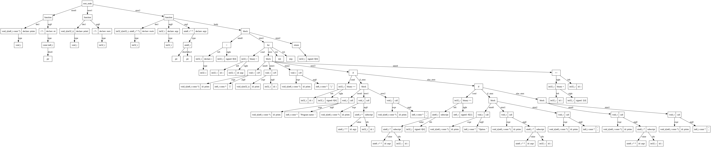

# Проектирование компилятора

Чтобы собрать проект:

```sh
mkdir build && cd build
cmake ..
make
```

Чтобы запустить тесты:

```sh
./all_tests
```

Посмотреть покрытие кода:

```sh
make coverage          # формирует gcovr отчёт
make show-coverage     # формирует отчёт и открывает в браузере чрез xdg-open
```

# Синтаксический разбор

Для сборки парсера

```sh
cd build
make parser
```
## Пример

Пример реализации функции main из задания лабораторной на описанном языке:

```c
void_t prints(const int8_t *str);
void_t printi(int32_t num);

int32_t main(int32_t argc, uint8_t **argv) {
    int32_t i = 0;
    for (; i < argc;) {
        prints("[");
        printi(i);
        prints("] ");
        if (i == 0) {
            prints("Program name: ");
            prints(argv[i]);
            prints("\n");
        } else if (argv[i][0] == '-') {
            prints("Option: ");
            prints(argv[i]);
            prints("\n");
        } else {
            prints(argv[i]);
            prints("\n");
        }
        i += 1;
    }
    return 0;
}
```
## Полученное в результате синтаксического анализа AST


## Полученное в результате семантического анализа AST


## Запуск парсера для кода из примера:

```sh
cd build

# запуск только синтаксического разбора
./parser --syntax ../tests/frontend/inputs/example/lab.lsp 

# запуск полного анализа
./parser ../tests/frontend/inputs/example/lab.lsp

# сформировать AST в формате png 
dot -Tpng asd.dot -o ast.png && xdg-open ast.png
```
